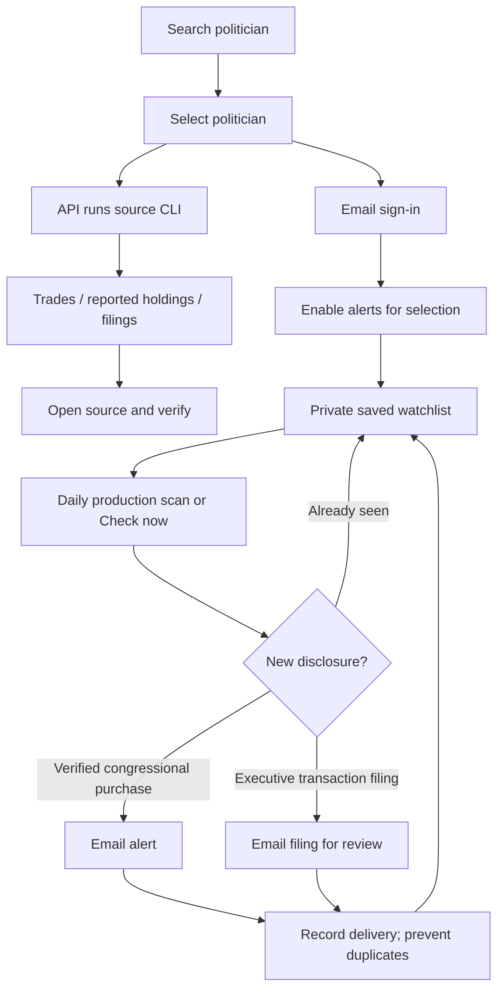

# Papertrail

**Live website:** [public-ledger-seven.vercel.app](https://public-ledger-seven.vercel.app). Email alerts require the owner's sign-in; public disclosure search remains separate from private watchlists.

A personal politician disclosure dashboard. Search a politician, inspect trades or annual reported holdings, and follow them for email alerts. Trade execution stays manual.

## Search and alerts

1. Search a name and select the matching politician.
2. Inspect Trades, Reported holdings or Filings. Amounts are disclosed ranges, not execution prices; annual holdings are snapshots.
3. Select **Follow purchases** (Congress) or **Follow new filings** (President), then use the emailed sign-in link.
4. Your selected politician remains selected after signing in. Select **Enable email alerts** on the alerts page.
5. Manage your selections in **Following** or **Email alerts**; use **Check now** for an extra scan or **Stop alerts** to unsubscribe.

Subscriptions seed existing records without emailing historical trades. Purchase alerts exclude uncertain OCR rows. OGE alerts announce new transaction filings requiring PDF verification. Up to 10 politicians; each scan reads the latest 100 records per politician. Email uses a dedicated Gmail app password. A daily production cron is configured for 09:00 Singapore time. Preview deployments support manual checks; Vercel only runs cron on production deployments. No politician is followed automatically.



## Local development

Python 3, Node.js and npm are required. The dashboard uses the same Python CLI as terminal searches. Install the Python requirements for OGE PDFs. House PDF extraction additionally uses `pdftotext` from Poppler. Interactive source browsing uses Chrome and the Playwright CLI.

```
npm install
python3 -m pip install -r requirements.txt
python3 serve.py
# In another terminal:
npm run dev
node check.mjs
```

The dashboard is at http://127.0.0.1:5187. The Python API is at port 8787. Configure private alerts in `.env.local`: `DATABASE_URL`, `ALERT_EMAIL`, `GMAIL_APP_PASSWORD`, `SESSION_SECRET`, `CRON_SECRET`, and local `PUBLIC_APP_URL`. Never commit credentials. Storage uses a separate `public_ledger` schema, a fixed owner email, and a signed HttpOnly session cookie.

## Source CLIs

```
./quiver people --name Pelosi
./quiver trades --name 'Nancy Pelosi' --limit 25
./quiver holdings --name 'Nancy Pelosi'
./house list --name Pelosi --year 2026
./house trades --url OFFICIAL_PTR_PDF_URL
./senate list --name Whitehouse --limit 25
./senate trades --url OFFICIAL_REPORT_URL
./oge list --name Trump
./oge trades --name Trump
./oge holdings --name Trump
./quiver login
./quiver browser snapshot
./quiver open --url https://www.quiverquant.com/congresstrading/
```

Run each CLI with `--help` or a subcommand with `--help` for filters, JSON/CSV output, downloads and saved inputs. Browser commands expose normal Playwright visitor interactions using dedicated persistent profiles outside the project. Login is interactive; paid features and CAPTCHA bypass are not provided. Browser cookies never go to Vercel.

`./local-trades --help` describes the optional local SQLite archive for source filings and immutable document snapshots. It is private to the Mac and independent of hosted alerts.

## Coverage

- Quiver: public congressional directory, recent dashboard trades, member trade history, latest annual reported assets. Source completeness is not guaranteed.
- House: public yearly filing index and strict digital PTR PDF extraction. Unsupported layouts are archived for review rather than inventing trades.
- Senate: normal Chrome search after the official acknowledgement. Hosted direct Senate filing searches link to the interactive official site; congressional trades use Quiver parsing.
- OGE: public index, directly available annual Parts 2/5/6 and latest transaction PDF. Attachments excluded. The September 2026 Trump transaction filing has an AI visual extraction review of all 1,156 rows, tied to its exact PDF URL and SHA-256 digest. Future scanned filings remain unchecked. OGE alerts announce new filings, not individually verified stock purchases.

The dashboard does not reconstruct current positions, invent exact execution prices or place trades. Source failures are shown explicitly. SMTP delivery uncertainty is retained for review rather than automatically resending potentially duplicate emails.
